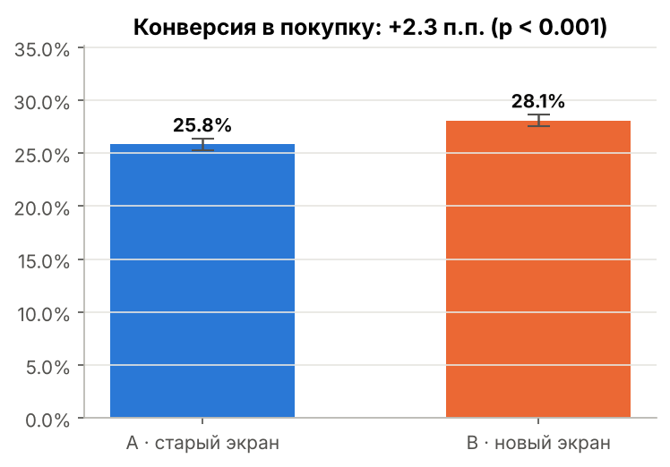
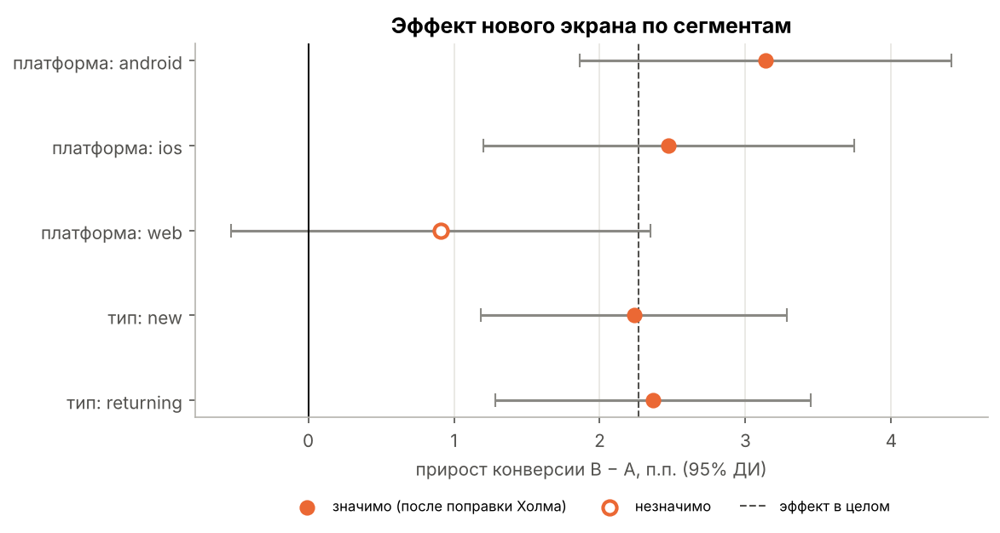
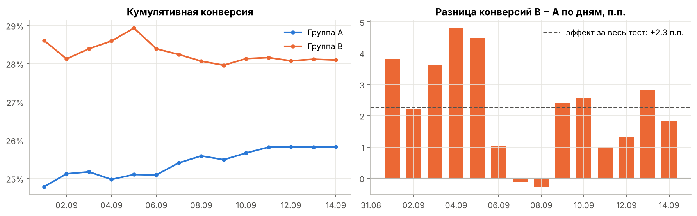

# A/B-тест нового экрана оплаты

Полный цикл анализа A/B-теста в e-commerce: от дизайна эксперимента и очистки данных до статистических выводов и продуктовой рекомендации.

**Стек:** Python · pandas · NumPy · SciPy · statsmodels · matplotlib · Jupyter

---

## Задача

Интернет-магазин переделал экран оплаты: одна страница вместо трёх шагов, сохранённые карты, Apple Pay / Google Pay. Нужно ответить на вопрос: **выкатывать ли новый экран на всех пользователей?**

| | Метрика | Критерий |
|---|---|---|
| Основная | Конверсия экрана оплаты в покупку | значимый рост, α = 0.05 |
| Вторичная | ARPU (выручка на пользователя) | рост |
| Guardrail | Средний чек | падение не более 3% |

Дизайн: сплит 50/50 по пользователю, 14 дней (две полные недели), мощность 80%, MDE +1.5 п.п.

## Результаты

| Метрика | A (контроль) | B (новый экран) | Разница | 95% ДИ | p-value |
|---|---|---|---|---|---|
| Конверсия | 25.83% | 28.09% | **+2.26 п.п. (+8.8%)** | +1.50 … +3.03 п.п. | 6.6e-09 |
| ARPU | 1 100 ₽ | 1 210 ₽ | **+110 ₽ (+10.0%)** | +60 … +158 ₽ (бутстрап) | < 0.001 |
| Средний чек | 4 259 ₽ | 4 307 ₽ | +48 ₽ | −73 … +174 ₽ (бутстрап) | 0.45 |



**Рекомендация: ✅ выкатывать.** Конверсия и ARPU выросли значимо, средний чек не пострадал. Эффект сосредоточен на мобильных платформах (Android +3.1 п.п., iOS +2.5 п.п.), на вебе прирост незначим. Следующий шаг — отдельный тест быстрых способов оплаты для веба.

Оценка эффекта для бизнеса: **≈ +2 500 заказов и ≈ +12 млн ₽ выручки в месяц** (пессимистичная граница — ≈ +6.7 млн ₽).



## Что сделано

1. **Дизайн эксперимента.** Расчёт размера выборки под MDE, обоснование длительности (недельная сезонность).
2. **Очистка данных.** Найдены и удалены дубли событий (~1%), QA-трафик (150 тестовых аккаунтов только в группе B — завышали бы конверсию теста), пользователи, попавшие в обе группы из-за бага сплитования (0.6%).
3. **Проверка корректности сплита.** SRM-тест (хи-квадрат) в целом и внутри платформ, динамика набора групп по дням.
4. **Проверка метода.** A/A-симуляция на контрольной группе: 1 000 случайных разбиений, доля ложных срабатываний 5.0% — тест откалиброван.
5. **Статистические тесты.** Z-тест для конверсии, t-тест Уэлча и бутстрап для ARPU и среднего чека (тяжёлый хвост, скошенность ≈ 3), Манна-Уитни для распределения чека.
6. **Устойчивость эффекта.** Кумулятивная динамика и проверка эффекта новизны: без первых трёх дней эффект +2.0 п.п., p < 0.001.
7. **Сегментный анализ** с поправкой Холма на множественные сравнения.
8. **Перевод в деньги** с учётом доверительного интервала.



## Структура репозитория

```
├── data/
│   └── checkout_ab_test.csv      # сырые данные эксперимента
├── notebooks/
│   └── ab_test_analysis.ipynb    # основной анализ с выводами
├── src/
│   ├── ab_stats.py               # функции: SRM, мощность, z/t-тесты, бутстрап, A/A
│   └── generate_data.py          # генерация датасета
├── images/                       # графики для отчёта
└── requirements.txt
```

## Как запустить

```bash
pip install -r requirements.txt
python src/generate_data.py        # опционально: пересоздать данные (seed фиксирован)
jupyter notebook notebooks/ab_test_analysis.ipynb
```

## Данные

Датасет синтетический: сгенерирован скриптом `src/generate_data.py` с фиксированным seed. В него специально заложены проблемы реальных логов (дубли, пересечения групп, тестовый трафик), неоднородный эффект по платформам и эффект новизны, чтобы анализ отрабатывал реальные сценарии.

**Поля:** `user_id`, `group` (A/B), `event_time` (первый заход на экран оплаты), `platform` (ios/android/web), `user_type` (new/returning), `converted` (0/1), `revenue` (сумма заказа, ₽).
